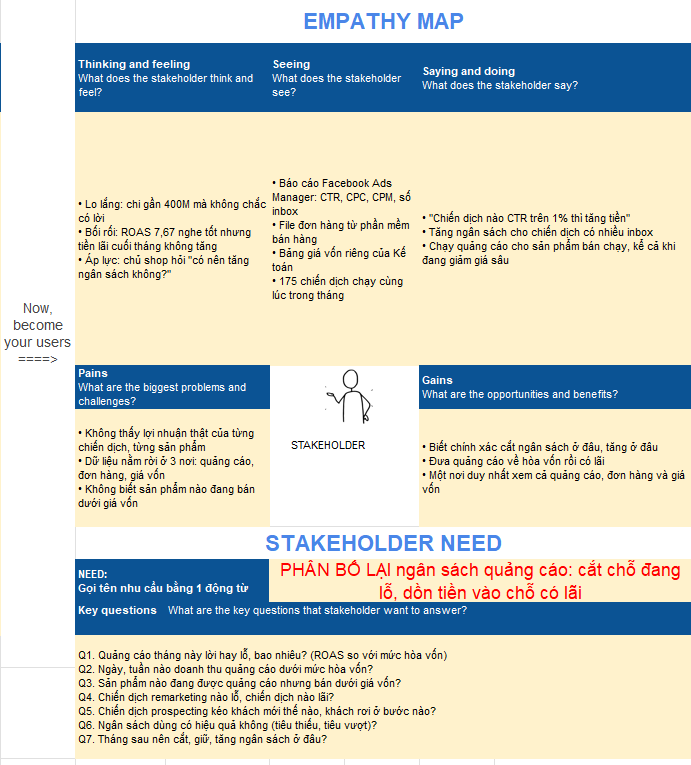
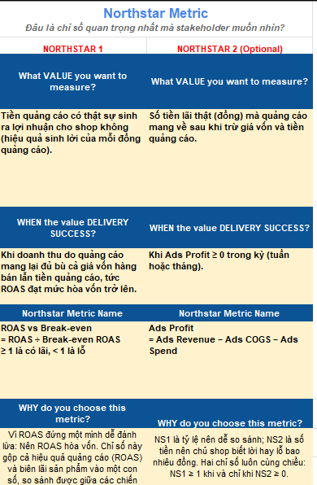
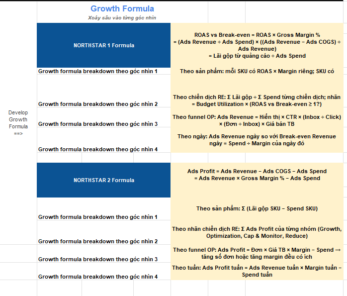
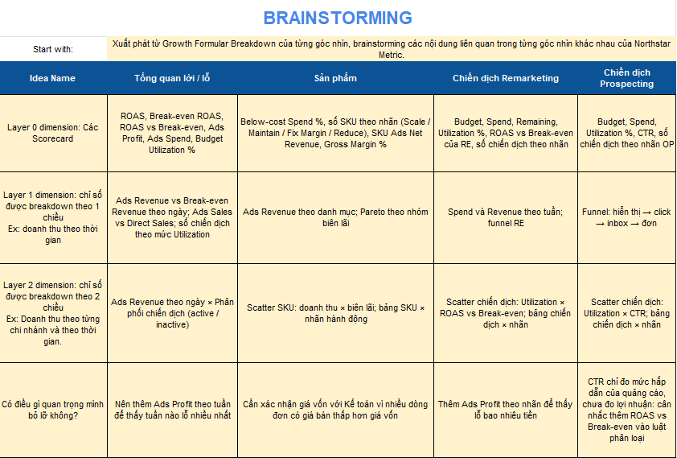
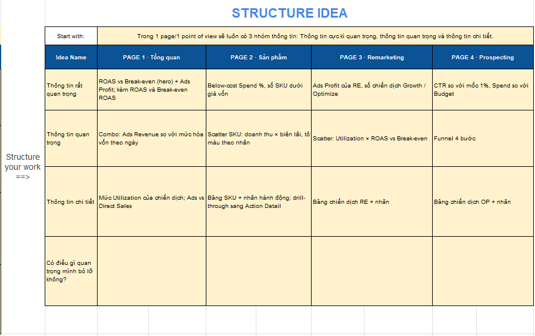
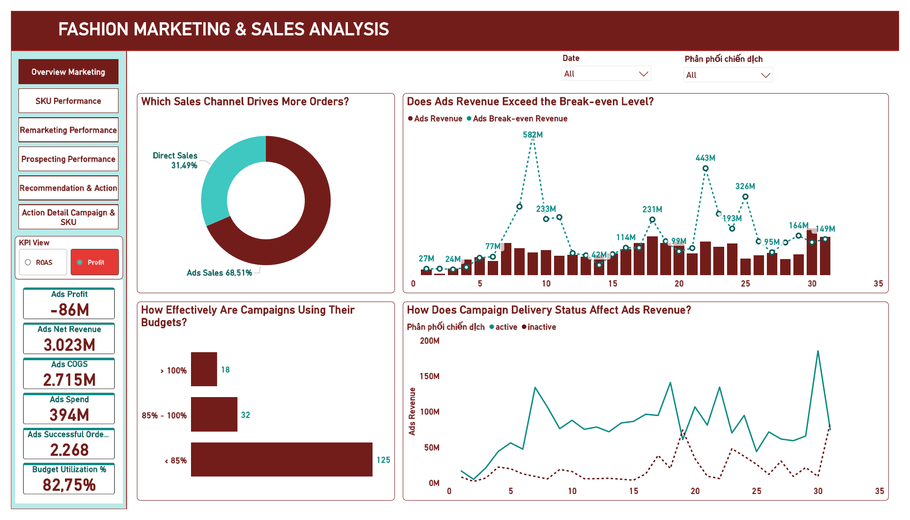
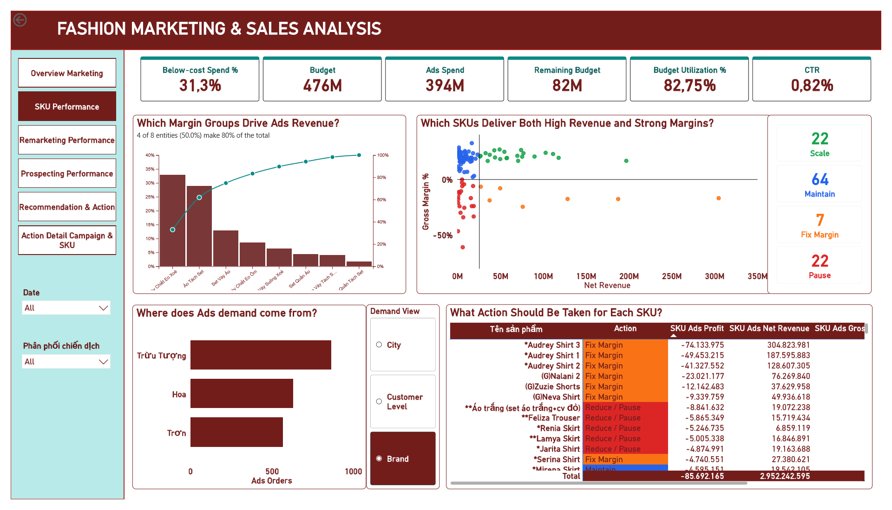
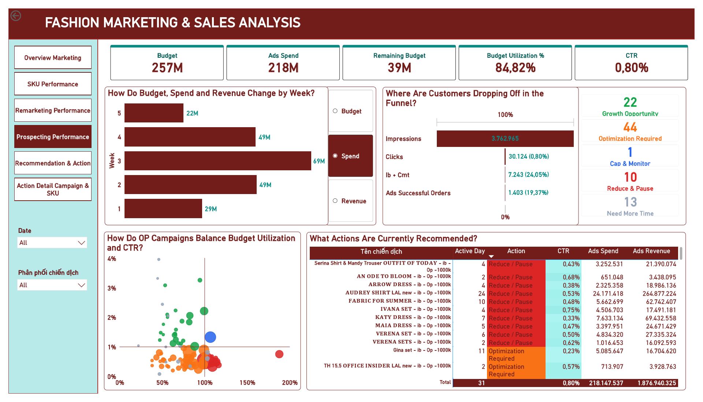

# Facebook Ads Performance: Online Fashion Store (May 2024)

A Power BI dashboard that answers two questions: is ad spend actually generating profit, and where should the budget be cut or increased?

## Table of Contents

1. [Context and Problem](#1-context-and-problem)
2. [Approach](#2-approach)
3. [Data and Model](#3-data-and-model)
4. [Key Metrics](#4-key-metrics)
5. [Dashboard](#5-dashboard)
6. [Insights and Recommendations](#6-insights-and-recommendations)

---

## 1. Context and Problem

In May 2024, the store ran 175 Facebook ad campaigns and spent 394M out of a total budget of 476M. ROAS reached 7.67, so on the surface the ads looked effective. However, the store still did not know:

- Whether ad spend was actually generating profit.
- If there were losses, which products and campaigns caused them.
- Where to increase or cut the budget next month.

The dashboard is designed for four groups of users:

| User | Question to answer |
| --- | --- |
| Shop owner | Are the ads making or losing money, and which products need a price adjustment? |
| Marketing manager | How should the budget be reallocated across campaign groups? |
| Ads specialist | Which campaigns should be scaled up, reduced or paused? |
| Sales staff | Which products should be prioritized, and which are being sold at a loss? |

---

## 2. Approach

The project went through four steps: identifying user needs with Design Thinking, preparing the data in Power Query, building the data model, and writing the DAX measures.

<details>
<summary><b>Design Thinking (Important)</b></summary>

Before building the dashboard, I used Design Thinking to clarify who the users are, what questions they need answered and which metrics should be used to measure them.

**Step 1: Empathize.** Identify the four user groups, the problems they face and when they use the dashboard. The key user is the Marketing manager, who approves the ad budget and is accountable for ad profitability.

<details>
<summary><b><i>5W1H</i></b></summary>


</details>

<details>
<summary><b><i>Empathy Map</i></b></summary>



</details>

<details>
<summary><b><i>Explore Dataset</i></b></summary>


</details>

**Step 2: Define POV.** Select two Northstar metrics: *ROAS vs Break-even* (a ratio, easy to compare across campaigns) and *Ads Profit* (the actual amount gained or lost). Then select four key points of view: products, Remarketing campaigns, Prospecting campaigns and time.

<details>
<summary><b><i>Northstar Metric</i></b></summary>



</details>

<details>
<summary><b><i>Define Point of View</i></b></summary>


</details>

<details>
<summary><b><i>Growth Formula</i></b></summary>



</details>

**Step 3: Ideate.** Generate ideas for metrics and charts for each point of view, then organize them into a layout for each dashboard page.

<details>
<summary><b><i>Brainstorming</i></b></summary>



</details>

<details>
<summary><b><i>Structure Idea</i></b></summary>



</details>

</details>

<details>
<summary><b>Power Query</b></summary>

The source data consists of four sheets in one Excel file. In addition to the four tables loaded into the model, I created two staging queries that are used only for joining tables and are not loaded into the model.

| Query | Source | Main steps |
| --- | --- | --- |
| fact_mkt_camp_by_sku_cost | Sheet `mkt_camp_by_sku_cost` | Remove repeated header rows and blank rows, add Campaign ID, add Audience Type column |
| fact_order | Sheet `order` | Set data types, add Style Sales column |
| dim_danh sach san pham | Sheet `danh sach san pham` | Set data types, remove blank rows |
| dim_date | Created with DAX | All dates in May 2024, with a week-of-month column |
| dim_mkt_camp_cost *(staging)* | Sheet `mkt_camp_cost` | Create Campaign ID |
| mkt_camp_id *(staging)* | Sheet `mkt_camp_by_sku_cost` | Get the Date + Product ID pairs with active ads |

**Creating Campaign ID.** Each row in the `mkt_camp_cost` sheet is one campaign on one day, identified by the combination of *Campaign name + Date + Amount spent*. I numbered each row to create the Campaign ID, then merged it into fact_mkt_camp_by_sku_cost using the same three columns. From `mkt_camp_cost`, only the Campaign ID column is taken, for joining purposes.

**Classifying campaigns.** The Audience Type column is set to *OP* (Prospecting, reaching new customers) if the campaign name contains “- Op -”, and *RE* (Remarketing, re-engaging past customers) if it contains “- Re -”.

**Classifying orders.** The mkt_camp_id query takes the distinct Date + Product ID pairs from the ads table and merges them into fact_order on Order date + Parent product ID. Matching rows are labelled *Ads Sales*; rows without a match are labelled *Direct Sales*.

</details>

<details>
<summary><b>Data Modeling</b></summary>

The model has two fact tables that share two dimension tables (see the diagram in [section 3](#3-data-and-model)):

- `dim_date[Date]` connects to `Ngày` (date) in the ads table and `Thời gian` (order date) in the orders table.
- `dim_danh sach san pham[Mã sản phẩm]` (product ID) connects to `Mã Sản phẩm` in the ads table and `Mã sản phẩm cha` (parent product ID) in the orders table.
- All relationships are one-to-many, with single-direction filtering from dimension to fact.

**Connecting the two fact tables with TREATAS.** The two fact tables have no common key: the ads table has no order ID, and the orders table has no campaign ID. The only thing they share is the *Date + Product ID* pair. Because filters only flow from dimension to fact, selecting a campaign does not filter the orders table.

TREATAS solves this. The measure takes the list of Date + Product ID pairs from the ads table under the current filters, then applies those pairs as a filter on the `Thời gian` and `Mã sản phẩm cha` columns of fact_order. This filters by exact pairs rather than by date and product separately, so there is no need for a many-to-many relationship or bidirectional filtering.

</details>

<details>
<summary><b>Key DAX Measures</b></summary>

The measures below are built on three base measures:

- **Ads Revenue** = units sold attributed to the campaign × selling price.
- **Ads COGS** = attributed units × cost price (purchase price is used when cost price is missing).
- **Ads Spend** = ad spend allocated by product.

<details>
<summary><i>Ads Gross Margin %</i></summary>

```dax
Ads Gross Margin % =
DIVIDE([Ads Revenue] - [Ads COGS], [Ads Revenue])
```

Gross margin of revenue generated by ads. This is the input for calculating the break-even ROAS.

</details>

<details>
<summary><i>Break-even ROAS</i></summary>

```dax
Break-even ROAS =
VAR GrossMargin = [Ads Gross Margin %]
RETURN
    IF(GrossMargin > 0, DIVIDE(1, GrossMargin))
```

The minimum ROAS needed for revenue to cover both product cost and ad spend. If the margin is zero or negative, there is no break-even point, so the measure returns blank.

</details>

<details>
<summary><i>ROAS vs Break-even</i></summary>

```dax
ROAS vs Break-even =
DIVIDE([_ROAS], [Break-even ROAS])
```

The Northstar metric of the dashboard. A value of 1 or above means the ads are profitable; below 1 means they are losing money. May 2024 came in at 0.78.

</details>

<details>
<summary><i>Below-cost Spend %</i></summary>

```dax
Below-cost Spend % =
VAR BelowCostProducts =
    FILTER(
        VALUES('dim_danh sach san pham'[Mã sản phẩm]),
        [Ads Gross Margin %] < 0
    )
RETURN
    DIVIDE(
        CALCULATE([Ads Spend], BelowCostProducts),
        [Ads Spend]
    )
```

Filters the products with a negative gross margin, then calculates the share of ad spend that went to this group out of total ad spend. May 2024 came in at 31.3%.

</details>

<details>
<summary><i>SKU Ads Net Revenue</i></summary>

```dax
SKU Ads Net Revenue =
VAR AdDayProduct =
    SUMMARIZE(
        'fact_mkt_camp_by_sku_cost',
        'fact_mkt_camp_by_sku_cost'[Ngày],
        'fact_mkt_camp_by_sku_cost'[Mã Sản phẩm]
    )
RETURN
    CALCULATE(
        SUMX(
            'fact_order',
            'fact_order'[Số lượng] * 'fact_order'[Giá]
                - COALESCE('fact_order'[Chiết khấu], 0)
        ),
        KEEPFILTERS(
            TREATAS(AdDayProduct, 'fact_order'[Thời gian], 'fact_order'[Mã sản phẩm cha])
        ),
        'fact_order'[Trạng thái] <> "Hệ thống hủy"
    )
```

Actual revenue from orders (price × quantity − discount, excluding system-cancelled orders) for each product on the days it was advertised. This is the measure that uses TREATAS to connect the two fact tables, as described under Data Modeling. KEEPFILTERS keeps the existing filters on fact_order instead of overriding them.

</details>

<details>
<summary><i>Action_RE</i></summary>

```dax
Action_RE =
VAR ShowRow =
    HASONEVALUE('fact_mkt_camp_by_sku_cost'[Tên chiến dịch])
        && NOT ISEMPTY('fact_mkt_camp_by_sku_cost')
VAR Utilization =
    CALCULATE([_Budget Utilization %], REMOVEFILTERS('dim_danh sach san pham'))
VAR ROASRatio =
    COALESCE(CALCULATE([ROAS vs Break-even], REMOVEFILTERS('dim_danh sach san pham')), 0)
VAR ActiveDays =
    CALCULATE([Campaign Active Days], REMOVEFILTERS('dim_danh sach san pham'))
RETURN
    IF(
        ShowRow,
        SWITCH(
            TRUE(),
            ActiveDays < 2, "Need More Time",
            Utilization <= 1 && ROASRatio >= 1, "Growth Opportunity",
            Utilization <= 1, "Optimization Required",
            ROASRatio >= 1, "Cap & Monitor",
            "Reduce / Pause"
        )
    )
```

Assigns an action label to each Remarketing campaign. The conditions are checked in order from top to bottom:

| Condition | Label |
| --- | --- |
| Active for fewer than 2 days | Need More Time |
| Within budget and ROAS vs Break-even ≥ 1 | Growth Opportunity |
| Within budget but ROAS vs Break-even < 1 | Optimization Required |
| Over budget and ROAS vs Break-even ≥ 1 | Cap & Monitor |
| All other cases | Reduce / Pause |

REMOVEFILTERS ensures the label is always calculated on the campaign's full data. When a user selects a product, the filter only decides which campaigns are shown; the campaign labels do not change.

</details>

</details>

---

## 3. Data and Model

The data covers ads, orders and the product catalog for May 2024.

| Table | Content | Grain | Rows |
| --- | --- | --- | --- |
| fact_mkt_camp_by_sku_cost | Spend, budget, impressions, engagement and units sold, allocated by product | One campaign × one product × one day | 3,844 |
| fact_order | Orders, selling price, discount, cost price, status | One product line in an order | 3,451 (2,858 orders) |
| dim_danh sach san pham | Product catalog, purchase price, cost price, brand | One product | 2,250 |
| dim_date | Calendar with week of month | One day | 31 |


---

## 4. Key Metrics

| Metric | Formula | Meaning |
| --- | --- | --- |
| ROAS | Ads Revenue ÷ Ads Spend | Revenue generated for every 1 VND spent on ads |
| Ads Gross Margin % | (Ads Revenue − Ads COGS) ÷ Ads Revenue | Gross margin of products sold through ads |
| Break-even ROAS | 1 ÷ Ads Gross Margin % | Minimum ROAS needed to avoid a loss |
| ROAS vs Break-even | ROAS ÷ Break-even ROAS | 1 or above means profitable |
| Ads Profit | Ads Revenue − Ads COGS − Ads Spend | Actual profit after product cost and ad spend |
| Below-cost Spend % | Ads Spend on negative-margin products ÷ total Ads Spend | Share of budget spent on products sold below cost |
| SKU Ads Net Revenue | Revenue after discount for each product on the days it was advertised | Evaluates profit and loss by product based on actual orders |
| Budget Utilization | Ads Spend ÷ Budget | Share of budget spent |

---

## 5. Dashboard

The dashboard has six pages. Click a page name to view its screenshot.

Full files: [PDF](power%20bi/Marketing_Campaign_Dashboard.pdf) · [Power BI (.pbix)](power%20bi/Marketing_Campaign_Dashboard.pbix)

<details>
<summary><b>Overview Marketing</b>: Are the ads making or losing money, and does revenue exceed the break-even level?</summary>



</details>

<details>
<summary><b>SKU Performance</b>: Which products sell well and are profitable, and which need adjustment?</summary>



</details>

<details>
<summary><b>Remarketing Performance</b>: Which campaigns targeting past customers are profitable, and which are losing money?</summary>


</details>

<details>
<summary><b>Prospecting Performance</b>: How are new-customer campaigns performing, and where do customers drop off?</summary>



</details>

<details>
<summary><b>Recommendation & Action</b>: Key findings and next steps in order of priority</summary>


</details>

<details>
<summary><b>Action Detail Campaign & SKU</b>: Campaigns and products grouped by action</summary>


</details>

---

## 6. Insights and Recommendations

### Key Findings

- Ads **lost 86M** in May despite a ROAS of 7.67. With a gross margin of only about 10%, a ROAS of 9.80 was needed to break even.
- **31% of the budget (124M)** was spent promoting products sold below cost. The Audrey Shirt 1–3 line alone lost about 165M.
- Of the 85 Remarketing campaigns, 28 were profitable (+60M), while 44 others lost a combined 120M.

### Insights

**1. High ROAS, but the ads still lost money.**
Ad revenue reached 3,023M against a cost of goods of 2,715M, giving a gross margin of only about 10%. At this margin, a ROAS of 9.80 is needed to break even. The actual ROAS was 7.67, meaning every 100 VND spent on ads brought back only about 78 VND in gross profit.

**2. Products sold below cost were the largest source of loss.**
26 products priced below cost (based on list price) used 124M in ad spend. This group brought in 978M in revenue but a gross profit of −142M; including ad spend, the loss was about 266M. Excluding this group, the remaining ads made a profit of about 180M.

**3. The Audrey Shirt 1–3 line caused about 165M in losses.**
All three items were sold below cost, with a margin of about −17% on total revenue of 621M. The losses were 74M (Shirt 3), 49M (Shirt 1) and 41M (Shirt 2). The two biggest loss-making campaigns of the month also promoted this line.

**4. Week 4 lost 45M because margins fell, not because the ads got worse.**
ROAS stayed at around 7.0–7.7 throughout the first four weeks. Gross margin fell from 9–13% in weeks 1–3 to 7.3% in week 4, as sales shifted toward lower-margin products.

**5. Remarketing campaigns split into two opposite groups.**
28 *Growth Opportunity* campaigns stayed within budget and earned 60M. 44 *Optimization Required* campaigns also stayed within budget but lost 120M. Budget can be shifted from the losing group to the profitable group without increasing total spend.

**6. A high CTR does not mean a profitable campaign.**
In Prospecting, campaigns with a CTR of 1% or higher lost 1.3M, while the rest earned 19M. The correlation between CTR and profit was only 0.06. CTR shows whether an ad attracts viewers, but not whether the products sold are profitable.

**7. Ads remain the main sales channel.**
68.5% of orders in the month included a product that was advertised on the same day. Cuts should therefore target the areas that are losing money rather than reducing ads across the board.

**8. 21 campaigns ran for fewer than 2 days and do not yet have enough data to evaluate.**
The *Need More Time* group sits far from the rest on the scatter chart. Because they ran so briefly, just a few orders can change their results significantly. Budget decisions should not yet be based on this group.

### Recommendations

| Priority | Action | Applies to | Owner | KPI to track |
| --- | --- | --- | --- | --- |
| 1 | Pause ads for products sold below cost and verify cost data with Accounting | 26 products, starting with Audrey Shirt 1–3 | Shop owner, Marketing manager | Below-cost Spend % |
| 2 | Adjust selling prices or reduce discounts before advertising again | *Fix Margin* products | Shop owner | ROAS vs Break-even ≥ 1 |
| 3 | Cut the budget by 30–50% and only advertise positive-margin products | 44 *Optimization Required* Remarketing campaigns | Marketing manager, ads specialist | Weekly Ads Profit |
| 4 | Gradually move the freed budget to the profitable group, increasing it by 10–20% per week | 28 *Growth Opportunity* Remarketing campaigns | Ads specialist | ROAS vs Break-even, Budget Utilization |
| 5 | Add ROAS vs Break-even to the Prospecting classification rule | Prospecting classification rule | Marketing manager | Share of *Growth* campaigns that are actually profitable |
| 6 | Keep a small test budget and review after at least 3 active days | 21 campaigns active for fewer than 2 days | Ads specialist | Active days, ROAS vs Break-even |

Actions 1 and 2 should be done first: as long as selling prices are below cost, the more effective the ads are, the more money the store loses.
