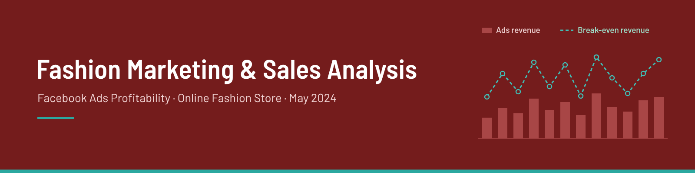
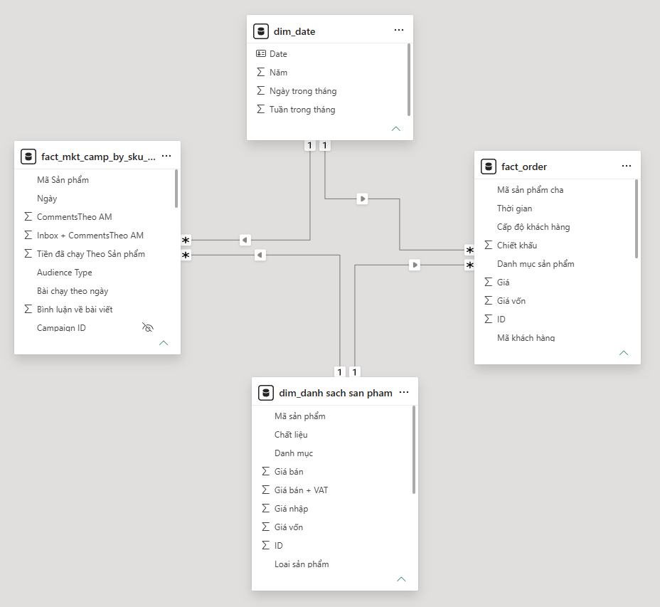
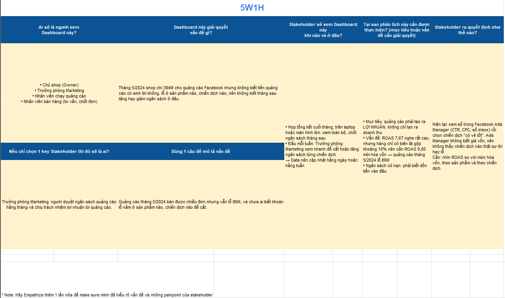
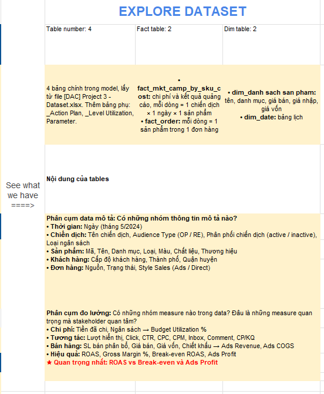
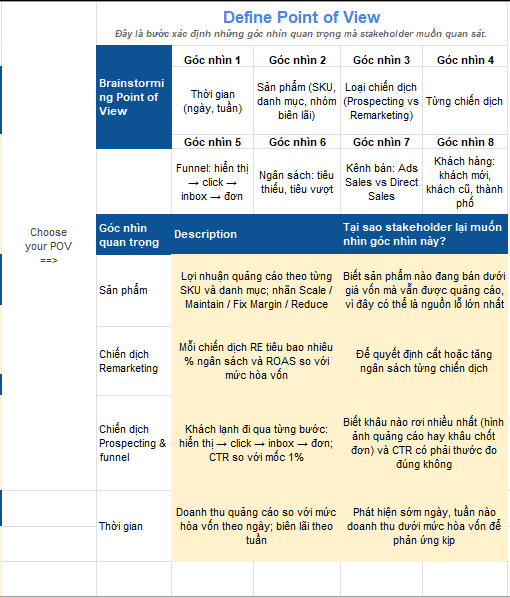
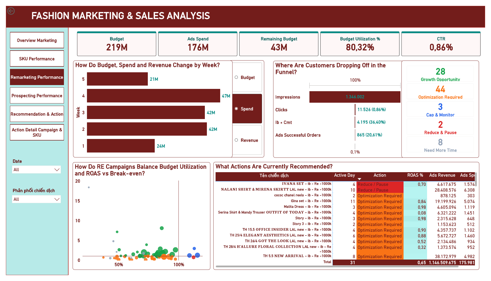
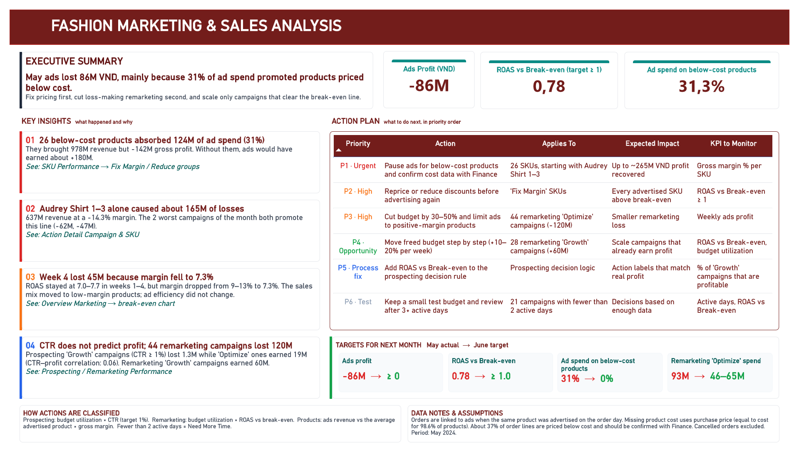
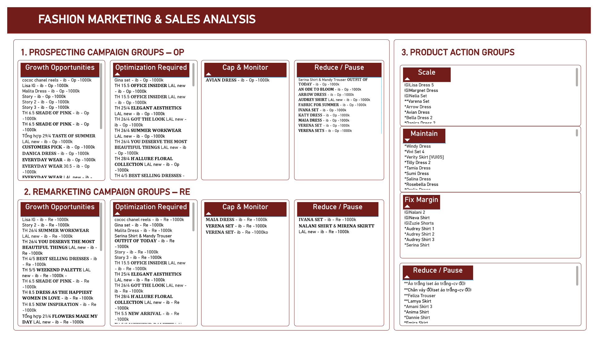

# Facebook Ads Performance: Online Fashion Store (May 2024)


A Power BI dashboard that answers two questions: is ad spend actually generating profit, and where should the budget be cut or increased?

## Table of Contents

1. [Background & Overview](#1-background--overview)
2. [Dataset Description & Data Structure](#2-dataset-description--data-structure)
3. [Design Thinking Process](#3-design-thinking-process)
4. [Main Process](#4-main-process)
5. [Key Insights & Visualizations](#5-key-insights--visualizations)
6. [Final Conclusion & Recommendations](#6-final-conclusion--recommendations)

---

## 1. Background & Overview

In May 2024, the store ran 175 Facebook ad campaigns and spent 394M out of a total budget of 476M. ROAS reached 7.67, so on the surface the ads looked effective. However, the store still did not know:

- Whether ad spend was actually generating profit.
- If there were losses, which products and campaigns caused them.
- Where to increase or cut the budget next month.

The dashboard is designed for four groups of users:

| User | Question to answer |
| --- | --- |
| Shop owner | Are the ads making or losing money, and which products need a price adjustment? |
| Marketing manager | How should the budget be reallocated across campaign groups? |
| Ads specialist | Which campaigns should be scaled up, reduced or paused? |
| Sales staff | Which products should be prioritized, and which are being sold at a loss? |

---

## 2. Dataset Description & Data Structure

### Table Schema

The data covers ads, orders and the product catalog for May 2024.

| Table | Content | Grain | Rows |
| --- | --- | --- | --- |
| fact_mkt_camp_by_sku_cost | Spend, budget, impressions, engagement and units sold, allocated by product | One campaign × one product × one day | 3,844 |
| fact_order | Orders, selling price, discount, cost price, status | One product line in an order | 3,451 (2,858 orders) |
| dim_danh sach san pham | Product catalog, purchase price, cost price, brand | One product | 2,250 |
| dim_date | Calendar with week of month | One day | 31 |

<details>
<summary><b>fact_mkt_camp_by_sku_cost</b>: main columns</summary>

| Column | Description |
| --- | --- |
| Tên chiến dịch | Campaign name |
| Ngày | Date the ad ran |
| Mã Sản phẩm | Product ID (key to the product table) |
| Giá bán | Selling price of the product |
| Tiền đã chạy theo sản phẩm | Ad spend allocated to the product |
| Ngân sách theo sản phẩm | Daily budget allocated to the product |
| Lượt hiển thị theo AM | Impressions allocated to the product |
| CTR | Link click-through rate of the campaign |
| Inbox + Comments theo AM | Messages and comments allocated to the product |
| SL bán được phân bổ theo tỉ lệ | Units sold attributed to the campaign |
| Phân phối chiến dịch | Campaign delivery status (active / inactive) |
| Audience Type | Added column: OP (Prospecting) or RE (Remarketing) |
| Campaign ID | Added column: one campaign on one day |

</details>

<details>
<summary><b>fact_order</b>: main columns</summary>

| Column | Description |
| --- | --- |
| ID | Order ID |
| Thời gian | Order date |
| Mã sản phẩm cha | Parent product ID (key to the product table) |
| Sản phẩm | Product variant (name and size) |
| Danh mục sản phẩm | Product category |
| Số lượng | Quantity |
| Giá | Selling price |
| Chiết khấu | Discount amount |
| Giá vốn | Cost price |
| Trạng thái | Order status |
| Thành phố | Customer city |
| Cấp độ khách hàng | Customer level |
| Style Sales | Added column: Ads Sales or Direct Sales |

</details>

<details>
<summary><b>dim_danh sach san pham</b>: main columns</summary>

| Column | Description |
| --- | --- |
| Mã sản phẩm | Product ID (primary key) |
| Tên sản phẩm | Product name |
| Danh mục | Product category |
| Thương hiệu | Brand |
| Giá bán | Selling price |
| Giá vốn | Cost price |
| Giá nhập | Purchase price, used when cost price is missing |

</details>

<details>
<summary><b>dim_date</b>: columns</summary>

| Column | Description |
| --- | --- |
| Date | Calendar date (primary key) |
| Năm | Year |
| Ngày trong tháng | Day of month |
| Tuần trong tháng | Week of month |

</details>

### Data Relationships



<details>
<summary><b>Relationships and connecting the two fact tables</b></summary>

The model has two fact tables that share two dimension tables:

- `dim_date[Date]` connects to `Ngày` (date) in the ads table and `Thời gian` (order date) in the orders table.
- `dim_danh sach san pham[Mã sản phẩm]` (product ID) connects to `Mã Sản phẩm` in the ads table and `Mã sản phẩm cha` (parent product ID) in the orders table.
- All relationships are one-to-many, with single-direction filtering from dimension to fact.

> [!NOTE]
> **Connecting the two fact tables with TREATAS.** The two fact tables have no common key: the ads table has no order ID, and the orders table has no campaign ID. The only thing they share is the *Date + Product ID* pair. Because filters only flow from dimension to fact, selecting a campaign does not filter the orders table.
>
> TREATAS solves this. The measure takes the list of Date + Product ID pairs from the ads table under the current filters, then applies those pairs as a filter on the `Thời gian` and `Mã sản phẩm cha` columns of fact_order. This filters by exact pairs rather than by date and product separately, so there is no need for a many-to-many relationship or bidirectional filtering.

</details>

---

## 3. Design Thinking Process

Before building the dashboard, I used Design Thinking to clarify who the users are, what questions they need answered and which metrics should be used to measure them.

> [!TIP]
> **Step 1: Empathize.** Identify the four user groups, the problems they face and when they use the dashboard. The key user is the Marketing manager, who approves the ad budget and is accountable for ad profitability.

<details>
<summary><b><i>5W1H</i></b></summary>



</details>

<details>
<summary><b><i>Empathy Map</i></b></summary>


</details>

<details>
<summary><b><i>Explore Dataset</i></b></summary>



</details>

> [!TIP]
> **Step 2: Define POV.** Select two Northstar metrics: *ROAS vs Break-even* (a ratio, easy to compare across campaigns) and *Ads Profit* (the actual amount gained or lost). Then select four key points of view: products, Remarketing campaigns, Prospecting campaigns and time.

<details>
<summary><b><i>Northstar Metric</i></b></summary>


</details>

<details>
<summary><b><i>Define Point of View</i></b></summary>



</details>

<details>
<summary><b><i>Growth Formula</i></b></summary>


</details>

> [!TIP]
> **Step 3: Ideate.** Generate ideas for metrics and charts for each point of view, then organize them into a layout for each dashboard page.

<details>
<summary><b><i>Brainstorming</i></b></summary>


</details>

<details>
<summary><b><i>Structure Idea</i></b></summary>


</details>

Full file: [Design Thinking (.xlsx)](powerbi/Design%20Thinking%20%E2%80%93%20Fashion%20Marketing%20%26%20Sales%20Dashboard.xlsx)

---

## 4. Main Process

The data was prepared in Power Query, then the two Northstar metrics were built with DAX.

<details>
<summary><b>Power Query</b></summary>

The source data consists of four sheets in one Excel file. In addition to the four tables loaded into the model, I created two staging queries that are used only for joining tables and are not loaded into the model.

| Query | Source | Main steps |
| --- | --- | --- |
| fact_mkt_camp_by_sku_cost | Sheet `mkt_camp_by_sku_cost` | Remove repeated header rows and blank rows, add Campaign ID, add Audience Type column |
| fact_order | Sheet `order` | Set data types, add Style Sales column |
| dim_danh sach san pham | Sheet `danh sach san pham` | Set data types, remove blank rows |
| dim_date | Created with DAX | All dates in May 2024, with a week-of-month column |
| dim_mkt_camp_cost *(staging)* | Sheet `mkt_camp_cost` | Create Campaign ID |
| mkt_camp_id *(staging)* | Sheet `mkt_camp_by_sku_cost` | Get the Date + Product ID pairs with active ads |

**Creating Campaign ID.** Each row in the `mkt_camp_cost` sheet is one campaign on one day, identified by the combination of *Campaign name + Date + Amount spent*. I numbered each row to create the Campaign ID, then merged it into fact_mkt_camp_by_sku_cost using the same three columns. From `mkt_camp_cost`, only the Campaign ID column is taken, for joining purposes.

**Classifying campaigns.** The Audience Type column is set to *OP* (Prospecting, reaching new customers) if the campaign name contains `- Op -`, and *RE* (Remarketing, re-engaging past customers) if it contains `- Re -`.

**Classifying orders.** The mkt_camp_id query takes the distinct Date + Product ID pairs from the ads table and merges them into fact_order on Order date + Parent product ID. Matching rows are labelled *Ads Sales*; rows without a match are labelled *Direct Sales*.

</details>

<details>
<summary><b>Northstar Metrics (DAX)</b></summary>

The Northstar metrics are built on three base measures:

- **Ads Revenue** = units sold attributed to the campaign × selling price.
- **Ads COGS** = attributed units × cost price (purchase price is used when cost price is missing).
- **Ads Spend** = ad spend allocated by product.

<details>
<summary><i>Ads Profit</i></summary>

```dax
_Ads Profit =
[Ads Revenue] - [Ads COGS] - [Ads Spend]
```

Actual profit after product cost and ad spend. May 2024 came in at -86M.

</details>

<details>
<summary><i>ROAS vs Break-even</i></summary>

```dax
Ads Gross Margin % =
DIVIDE([Ads Revenue] - [Ads COGS], [Ads Revenue])
```

Gross margin of revenue generated by ads. This is the input for calculating the break-even ROAS.

```dax
Break-even ROAS =
VAR GrossMargin = [Ads Gross Margin %]
RETURN
    IF(GrossMargin > 0, DIVIDE(1, GrossMargin))
```

The minimum ROAS needed for revenue to cover both product cost and ad spend. If the margin is zero or negative, there is no break-even point, so the measure returns blank.

```dax
ROAS vs Break-even =
DIVIDE([_ROAS], [Break-even ROAS])
```

The Northstar metric of the dashboard. A value of 1 or above means the ads are profitable; below 1 means they are losing money. May 2024 came in at 0.78.

</details>

</details>

---

## 5. Key Insights & Visualizations

The dashboard has six pages.

Full files: [PDF](powerbi/Fashion%20Marketing%20%26%20Sales%20Analysis.pdf) · [Power BI (.pbix)](powerbi/Fashion%20Marketing%20%26%20Sales%20Analysis.pbix)

### Overview Marketing

*Are the ads making or losing money, and does revenue exceed the break-even level?*


**Observations**

> **Ads covered the cost of goods but not the ad spend.**
> Ads Profit is what remains of ads revenue after deducting the cost of goods and the ad spend. Ads Net Revenue was 3,023M and Ads COGS was 2,715M, leaving about 308M before advertising, which is less than the Ads Spend of 394M. As a result, Ads Profit was -86M. The ads generated sales, but the margin on those sales was not enough to pay for the advertising.
>
> **Ads revenue stayed below the break-even level on most days.**
> The chart compares daily ads revenue (bars) with the revenue needed to break even (dotted line). On most days the line sits above the bars, with the largest gaps on day 9 (582M), day 22 (443M) and day 25 (326M). The bars reach the line on only a few days, so the loss built up gradually across the month.
>
> **Ads are the main sales channel.**
> Ads Sales account for 68.51% of orders, compared with 31.49% for Direct Sales. More than two thirds of orders come through advertising, so the business depends heavily on ads to generate sales. Reducing ad activity across the board would therefore also reduce a large share of orders.
>
> **Most campaigns did not use their full budget.**
> Budget Utilization shows how much of the planned budget was actually spent. 125 of 175 campaigns used less than 85% of their budget, 32 used 85-100%, and 18 spent more than their budget. Overall Budget Utilization was 82.75%. Since most campaigns had budget left, the loss comes from campaigns whose revenue does not cover their costs.

### SKU Performance

*Which products sell well and are profitable, and which need adjustment?*


**Observations**

> **About a third of ad spend went to products sold below cost.**
> Below-cost Spend % measures the share of ad spend used on products whose selling price is below cost. The value is 31.3%, meaning nearly a third of the ad budget went to products that lose money on each sale. For these products, more sales lead to a larger loss.
>
> **Ads revenue is concentrated in a few product groups.**
> The Pareto chart ranks product groups by ads revenue, with the line showing the cumulative share. 4 of 8 groups make up 80% of ads revenue, and the first two alone account for more than 60%. Ads revenue depends heavily on a small number of product groups, so the results of these groups have the largest effect on the total.
>
> **Some of the best-selling products have a negative margin.**
> The scatter chart places each product by net revenue and gross margin; products below the 0% line lose money on each sale. 22 products are labelled *Scale*, 64 *Maintain*, 7 *Fix Margin* and 22 *Pause*. The 7 *Fix Margin* products (orange) are among the highest in revenue, reaching about 300M, yet sit below 0% margin. These products sell well, but at their current price they do not make a profit.
>
> **Audrey Shirt 1-3 account for most of the loss.**
> The action table ranks products by ads profit. Audrey Shirt 3, 1 and 2 are at the top, with losses of 74M, 49M and 41M, all labelled *Fix Margin*. Their combined loss of about 164M is larger than the total Ads Profit of -86M shown at the bottom of the table. This means the remaining products together made a profit, and the overall loss comes mainly from this one product line.

### Remarketing Performance

*Which campaigns targeting past customers are profitable, and which are losing money?*



**Observations**

> **ROAS vs Break-even is below 1.**
> Remarketing shows ads to customers who have already interacted with the store. Because these customers already know the brand, the main question is whether the money spent brings back enough revenue, which is measured by ROAS vs Break-even. A value of 1 means revenue just covers the cost of goods and the ad spend. The group's value is 0.65, so Remarketing revenue reached only about two thirds of the break-even level.
>
> **Most campaigns sit near or below the break-even line.**
> On the scatter chart, each dot is a campaign, placed by how much of its budget it used and its ROAS vs Break-even. 44 of the 85 campaigns stayed within budget but fell below break-even (*Optimization Required*), compared with 28 that stayed within budget and reached break-even (*Growth Opportunity*). Only 5 campaigns exceeded their budget (3 *Cap & Monitor*, 2 *Reduce & Pause*), and 8 are *Need More Time*. The main issue is that many campaigns do not earn back what they spend.
>
> **Past customers convert well after clicking.**
> The funnel shows that only 0.86% of impressions led to a click (11,526 clicks). After the click, 36.40% sent a message or comment, and 20.61% of those completed an order (865 orders). Since the later steps convert well, the low ROAS vs Break-even is not caused by customers dropping out after they click.
>
> **Part of the budget remained unused.**
> Spend was 176M out of a 219M budget (80.32%), leaving 43M unused. Weekly spend rose from 24M in week 1 to a peak of 47M in week 4. With most campaigns already under budget, adding more budget would not by itself improve results.

### Prospecting Performance

*How are new-customer campaigns performing, and where do customers drop off?*


**Observations**

> **CTR is below the 1% threshold.**
> Prospecting shows ads to people who have not interacted with the store before. For this audience, the first step is getting people to notice the ad and click, so CTR is the main measure. The group's CTR is 0.80%, below the 1% threshold used on the scatter chart. Only 23 of the 90 campaigns reach 1% or higher (22 *Growth Opportunity*, 1 *Cap & Monitor*), while 54 fall below it (44 *Optimization Required*, 10 *Reduce & Pause*). The remaining 13 are *Need More Time*. Most Prospecting ads are not yet attracting enough attention from new audiences.
>
> **10 campaigns spent over budget with a low CTR.**
> The *Reduce & Pause* campaigns appear as red dots to the right of the 100% budget line and below the 1% CTR line. They spent more than planned while bringing in fewer clicks than the threshold. The largest in the table is AUDREY SHIRT LAL, which ran for 24 days, spent 24.2M and had a CTR of 0.53%.
>
> **Wider reach, but fewer people continue after clicking.**
> Prospecting reached 3,762,965 impressions, nearly three times the 1,346,002 in Remarketing. After clicking, however, only 24.05% sent a message or comment, compared with 36.40% in Remarketing. 19.37% of those completed an order (1,403 orders). New audiences are less familiar with the store, so a smaller share move from clicking to contacting the store.
>
> **Prospecting receives more budget than Remarketing.**
> Spend was 218M out of a 257M budget (84.82%), compared with 176M in Remarketing, and weekly spend peaked in week 3 at 69M. Because more money goes to Prospecting, its CTR has a large influence on how efficiently the overall ad budget is used.

### Recommendation & Action

*Key findings and next steps in order of priority*



**Observations**

> This page brings the findings together: an executive summary with three headline KPIs (Ads Profit, ROAS vs Break-even and Below-cost Spend %), four key insights, an action plan in order of priority and targets for the next month.

### Action Detail Campaign & SKU

*Campaigns and products grouped by action*



**Observations**

> Each campaign and product is listed under its action label. Selecting a campaign shows only the products it advertised, and selecting a product shows only the campaigns that advertised it. The action labels are always calculated on the full data, so they do not change when a selection is made.

---

## 6. Final Conclusion & Recommendations

### Key Insights

- **Ads lost money overall.** Ads lost 86M in May. ROAS vs Break-even was 0.78 against a target of 1, meaning ads revenue reached only 78% of the level needed to cover cost of goods and ad spend.
- **Below-cost products.** 31.3% of ad spend went to products sold below cost. For these products, every additional sale increases the loss.
- **Audrey Shirt 1-3.** This product line alone caused about 165M of losses, with 637M in revenue at a -14.3% margin. The two worst campaigns of the month (-62M and -47M) both promoted this line.
- **Week 4.** Lost 45M as gross margin fell from 9-13% in weeks 1-3 to 7.3%, while ROAS stayed at 7.0-7.7. The sales mix moved toward lower-margin products; ad efficiency did not change.
- **Remarketing.** 28 *Growth Opportunity* campaigns earned 60M, while 44 *Optimization Required* campaigns lost 120M.
- **Prospecting.** CTR is not a reliable signal of profit. *Growth Opportunity* campaigns (CTR ≥ 1%) lost 1.3M, while *Optimization Required* campaigns earned 19M.
- **Sales channel.** Ads Sales account for 68.51% of orders, so ads remain the main sales channel.
- **Short-running campaigns.** 21 campaigns ran for fewer than 2 active days and cannot be evaluated yet.

### Recommendations

1. **Pause ads for products sold below cost.** Start with Audrey Shirt 1-3 among the 26 products, and confirm cost data with Finance. Expected impact: up to about 265M in profit recovered. KPI: Gross margin % per SKU.
2. **Reprice or reduce discounts** for *Fix Margin* products before advertising them again. KPI: ROAS vs Break-even ≥ 1.
3. **Cut the budget by 30-50%** for the 44 *Optimization Required* Remarketing campaigns (-120M) and limit ads to positive-margin products. KPI: weekly Ads Profit.
4. **Move the freed budget step by step** to the 28 *Growth Opportunity* Remarketing campaigns (+60M), increasing it by 10-20% per week. KPI: ROAS vs Break-even, Budget Utilization.
5. **Add ROAS vs Break-even to the Prospecting classification rule**, so that *Growth* campaigns are also profitable ones. KPI: % of *Growth* campaigns that are profitable.
6. **Keep a small test budget** for the 21 short-running campaigns and review them after at least 3 active days. KPI: Active days, ROAS vs Break-even.

Actions 1 and 2 should be done first: as long as selling prices are below cost, the more effective the ads are, the more money the store loses.
